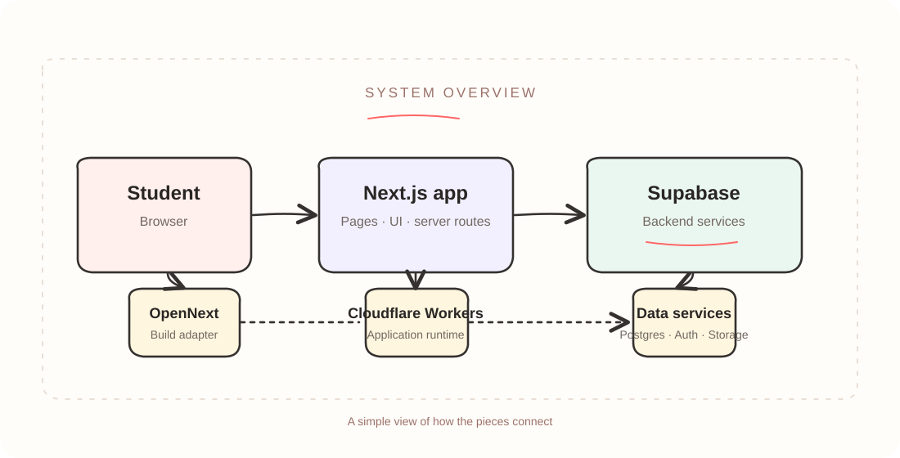

  

<h1 align="center">us</h1>

<strong>just us.</strong> A private space to meet people from your own college.

  
  
  

PRIVATE BY DESIGN · CAMPUS EXCLUSIVE · MADE FOR STUDENTS

---

  <a href="#-the-idea">The idea</a> · <a href="#-the-experience">The experience</a> · <a href="#-technology">Technology</a> · <a href="#-get-started">Get started</a> · <a href="#-contributing">Contribute</a>

## ♡ The idea

College is full of people you see every day but never really get to know.

**us** is a private, campus-only dating app built to make those connections a little easier. It gives students a space to create a profile and meet people from their own college — without the noise of a conventional social network.

The idea is simple: make meeting someone feel a little more personal.

> **Current stage:** us is in pre-launch. Student onboarding, profiles, campus search, invitations and account tools are implemented. The full like, match and chat experience is still being built.

## ✳ The experience

The product is being built around one simple journey:

  
  
  
  

<em>Discover someone. Feel a connection. See where it goes.</em>

This is the intended product journey, not a list of features that are already live. Likes, matching and chat are not currently completed user-facing flows.

## ◇ Built around privacy

Campus exclusivity should mean something.

- **Campus verification:** accounts go through the appropriate student verification flow.
- **Private identity data:** USN, email and authentication identifiers are kept separate from public profile information.
- **Protected account features:** authenticated routes and server-side checks protect sensitive operations.
- **A focused experience:** the product is about meeting people, not building another public social feed.

## ⚙ Technology

The stack is intentionally modern, with a focus on a maintainable application and a reliable deployment workflow.

<strong>APPLICATION</strong>

  
  
  
  

<strong>BACKEND &amp; DATA</strong>

  
  

<strong>DEPLOYMENT &amp; TOOLING</strong>

  
  
  

## ⌘ How it fits together

Next.js powers the web experience and server-side application logic. Supabase provides the database, authentication and storage. OpenNext packages the application for deployment to Cloudflare Workers.

  

### Repository map

| Path | Purpose |
|---|---|
| <code>src/app/</code> | App Router pages and API route handlers |
| <code>src/components/</code> | Reusable landing, onboarding, profile, search, settings and admin UI |
| <code>src/lib/</code> | Authentication, onboarding, Supabase clients, profiles, photos, feedback, verification, security and admin logic |
| <code>supabase/migrations/</code> | Ordered database migrations |
| <code>supabase/seed.sql</code> | Local seed data |
| <code>scripts/</code> | Development and release utilities |
| <code>wrangler.jsonc</code> · <code>open-next.config.ts</code> | Cloudflare Workers and OpenNext configuration |

The main student-facing routes include <code>/</code>, <code>/login</code>, <code>/onboarding/*</code>, <code>/home</code>, <code>/search</code>, <code>/profile</code>, <code>/profile/edit</code>, <code>/u/[username]</code>, <code>/invite/[token]</code>, <code>/feedback</code> and <code>/settings</code>. The <code>/inside</code> area is a protected internal admin surface, not part of normal student navigation.

## ⇢ Get started

Want to explore the code or contribute? Here's how to run the project locally.

### Requirements

- [Node.js](https://nodejs.org/) **24.22.1**
- [pnpm](https://pnpm.io/) **11.21.0**
- [Docker Desktop](https://www.docker.com/products/docker-desktop/) running for the local Supabase stack
- Git

### 1. Clone and install

~~~bash
git clone https://github.com/us-justus/us.git
cd us
pnpm install
~~~

The repository pins pnpm through the <code>packageManager</code> field in <code>package.json</code>.

### 2. Start local Supabase

Make sure Docker Desktop is running, then start the local services:

~~~bash
pnpm exec supabase start
~~~

On the first run, Supabase may need to download its Docker images. Apply the repository's migrations and seed data to the **local** database:

~~~bash
pnpm exec supabase db reset
~~~

This resets the local Supabase database and reapplies the migrations and seed file. Do not point this workflow at a hosted staging or production database.

### 3. Configure local environment variables

The repository does not include a committed <code>.env.example</code>. Create a local <code>.env.local</code> file in the project root. It is ignored by Git.

Get the local API URL, anon key and service-role key from:

~~~bash
pnpm exec supabase status
~~~

Use the values printed for your **local** Supabase instance:

~~~dotenv
NEXT_PUBLIC_SUPABASE_URL=http://127.0.0.1:54321
NEXT_PUBLIC_SUPABASE_ANON_KEY=<local-anon-key>
SUPABASE_SERVICE_ROLE_KEY=<local-service-role-key>

# Required for the /inside admin login locally (16+ characters).
ADMIN_SECRET_KEY=<random-local-secret-at-least-16-characters>

# Set these to test email verification, feedback replies and waitlist email sending.
BREVO_API_KEY=<brevo-api-key>
BREVO_SENDER_EMAIL=<verified-sender-address>
# Optional; defaults to "us":
BREVO_SENDER_NAME=us
~~~

Replace placeholders with your own local or authorized development values. The app can start without Brevo credentials, but outbound email flows will not work until <code>BREVO_API_KEY</code> and <code>BREVO_SENDER_EMAIL</code> are configured. Never commit <code>.env.local</code>, paste secrets into issues, or use production credentials for local development. The service-role key, admin secret and Brevo API key are server-side secrets; do not prefix them with <code>NEXT_PUBLIC_</code>.

### 4. Start the app

~~~bash
pnpm dev
~~~

Open [http://localhost:3000](http://localhost:3000).

<strong>Useful local commands</strong>

~~~bash
pnpm lint
pnpm exec tsc --noEmit
pnpm test:inside

# Local Supabase
pnpm exec supabase status
pnpm exec supabase db reset
pnpm exec supabase stop
~~~

- <code>pnpm lint</code> runs ESLint.
- <code>pnpm exec tsc --noEmit</code> runs the TypeScript check without emitting files.
- <code>pnpm test:inside</code> runs the Node.js test files listed in <code>package.json</code>, covering admin, authentication, onboarding, feedback and related security logic.

Run the relevant checks before opening a pull request. Some tests or application flows may require local environment configuration.

<strong>Optional: staging-connected development</strong>

The <code>pnpm dev:staging</code> script loads environment variables from <code>.env.staging.local</code> and then starts Next.js in development mode. This file is Git-ignored and must contain only separately provisioned staging configuration.

Use this only when authorized to work against the staging project. Do not copy production values into it, and do not use it as a substitute for the isolated local Supabase setup above.

<strong>Internal admin area</strong> — local testing only

The <code>/inside</code> area is an internal admin surface and uses the existing Supabase Auth system; it does not have a separate password or client-supplied admin-key login.

A successful <code>/inside</code> login requires all of the following:

- A valid Supabase email-and-password sign-in. The identifier can be an email address, phone number or USN.
- Current membership for that authenticated user in <code>public.admin_users</code>, checked through the <code>is_admin()</code> database function.
- A configured server-side <code>ADMIN_SECRET_KEY</code> (at least 16 characters). After the first two checks pass, the server uses this key to sign a 12-hour, HttpOnly admin-session cookie. The key itself is never entered in the login form or sent to the browser.
- On subsequent requests, the server verifies the signed cookie, its expiry, the live Supabase session for the same user and current admin membership again.

For local-only testing:

1. Start the local Supabase stack and apply the migrations as described above.
2. Create a test account in the local Supabase instance and note its user ID from the local <code>auth.users</code> table.
3. Add that test user's ID to <code>public.admin_users</code> in the **local** database. Only do this for a test account in your local database.
4. Set <code>ADMIN_SECRET_KEY</code> in <code>.env.local</code> to a random local value at least 16 characters long.
5. Open <code>/inside</code> and sign in with the test account's email, phone number or USN and its Supabase password. Do not enter <code>ADMIN_SECRET_KEY</code> in the form.

The admin login also uses the server-side service-role configuration for protected login-resolution and rate-limit operations. Do not grant admin membership to real users or run these steps against a hosted database unless the project maintainers have explicitly authorized it. The admin area is not linked from the normal product UI.

## Deployment

The production Worker configuration is maintained in <code>wrangler.jsonc</code> and <code>open-next.config.ts</code>. OpenNext generates the Worker entry point and static assets before Wrangler deploys them to Cloudflare Workers.

Deployment credentials and server-side secrets are managed outside the repository. Production deployment is a maintainer-controlled process; contributors should not run deployment or rollback commands unless explicitly asked to do so.

## ♡ Contributing

**us is being built one step at a time.**

If you're interested in helping shape the product or improve the codebase, contributions are welcome.

1. Read the [Contribution Guidelines](CONTRIBUTING.md).
2. Review the [Code of Conduct](CODE_OF_CONDUCT.md).
3. Create a dedicated branch.
4. Keep changes focused and test what you change.
5. Open a pull request for review.

Please don't commit credentials, environment files, generated build output or local database data.

## More about the project

  
  
  
  

---

  <strong>just us.</strong> 
  Made with care, for the people around you.

